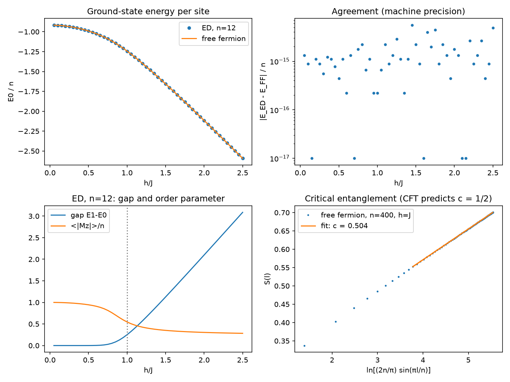

# tfim-simulability

**Where does classical simulation of Ising quantum dynamics break down?**
**Tensor-network benchmarks of Trotterized transverse-field Ising circuits.**

[](https://github.com/Kaempy/tfim-simulability/actions/workflows/tests.yml)

An independent computational physics project by Abolanle Mary Adebanjo.

<!-- > **How this was built.** The Phase 0 code was scaffolded with AI assistance. I review and test every result, and re-derive the physics behind it by hand, before building on it. -->

---

## Motivation

The best-known claims of quantum utility and quantum advantage use Ising-type circuits. Each claim depends on two kinds of error:

- **Trotter error**, which a quantum computer incurs when it approximates continuous-time dynamics with discrete gates.
- **Truncation error**, which a classical tensor-network (MPS) simulator incurs when it caps the entanglement it can represent.

This project measures both, side by side, in the one-dimensional transverse-field Ising model (TFIM):

$$
H = -J\sum_i Z_i Z_{i+1} \;-\; h\sum_i X_i .
$$

The model has a quantum critical point at $h = J$ [1, 2]. It also maps exactly onto free fermions through the Jordan–Wigner transformation. That gives an **exact reference for hundreds of spins**, far beyond what brute-force exact diagonalization can reach, so the errors can be _measured_ rather than estimated.

### Related work this project builds on

Both error sources are active research topics in S. Todo's group at the University of Tokyo. This project is an independent, small-scale benchmark that uses the TFIM's exact solution as ground truth for the questions those papers raise.

- **Truncation error in tensor-network circuit simulation.**
  - Yanagisawa _et al._ compare Simple Update with canonical-form MPS updates for simulating circuits [6].
  - Kawabe _et al._'s Matrix Product Evolution builds the tensor network along circuit depth and tracks how its bond dimension grows in time [7].
  - Goto _et al._ replace TEBD's truncation error with statistical error through tensor-network Monte Carlo [8].
  - Phase 2 here measures MPS truncation error against an exact answer, which is the quantity these methods aim to control.
- **Trotter error.** Murota _et al._ remove the systematic Trotter error by reversing the closed-form error dynamics [9]. Phase 1b measures exactly that systematic error in the TFIM, where it can be computed without approximation.
- **Long-range TFIM.** Shiratani and Todo map the critical behaviour of the long-range transverse-field Ising chain [10]. That model is extension (a): free fermions no longer apply there, so tensor networks become the reference.

## Research questions

1. **Entanglement and phase.** After a quench into the ferromagnetic, critical or paramagnetic regime:
   - How fast does half-chain entanglement grow?
   - What bond dimension χ(t) keeps the MPS error below ε?
2. **Trotter error in observables.** How do the errors in ⟨Zᵢ⟩, ⟨ZᵢZⱼ⟩ and the Loschmidt echo scale with:
   - the time step dt, h/J, time t, and system size N;
   - first- vs second-order product formulas?

   And how tight are commutator-scaling bounds [4] for this model?

3. **Simulability map (main result).** In the (h/J, t) plane:
   - Where is a fixed-χ MPS simulation _more_ accurate than a fixed-dt Trotter circuit, and where is it _less_?
   - Where would a quantum device have the edge?
4. **Extensions:**
   - (a) the long-range TFIM, where free fermions no longer apply and MPS is the only scalable reference;
   - (b) noisy simulation with zero-noise extrapolation;
   - (c) a minimal MPS-evolution engine written in Rust.

## Status

| Phase | Content                                                                                                                                    | Status  |
| ----- | ------------------------------------------------------------------------------------------------------------------------------------------ | ------- |
| 0     | Sparse exact diagonalization; free-fermion (Majorana) ground state; cross-validation tests                                                 | ✅ done |
| 1a    | Exact free-fermion **quench dynamics** for N = 50–200; entanglement growth S(t)                                                            | ⏳ next |
| 1b    | Qiskit Trotter circuits (1st/2nd order); Trotter error vs exact reference                                                                  | ⏳      |
| 2     | MPS circuit simulation [5] (Aer `matrix_product_state` + quimb cross-check; ALPS 3.0 [11] for ground states); error vs χ; simulability map | ⏳      |
| 3     | Extension; technical report; v1.0 release with DOI                                                                                         | ⏳      |

### Phase 0 results



- **Validation.** Exact diagonalization (N = 12) and the free-fermion solution agree to **~5 × 10⁻¹⁵** per site across 0 < h/J ≤ 2.5. Ground-state energy, gap and entanglement entropy all match.
- **Phase transition.** It is visible in the gap closing and the drop in the order parameter near h = J.
- **Critical entanglement.** At h = J with N = 400, the entanglement entropy follows the Calabrese–Cardy form [3] $S(\ell) = \frac{c}{6}\ln\big[\frac{2N}{\pi}\sin\frac{\pi\ell}{N}\big] + \text{const}$. The fitted value is **c = 0.504**, against the exact value c = 1/2 (Ising CFT).

## Layout

```
src/tfim/ed.py            sparse exact diagonalization, entanglement, magnetization
src/tfim/free_fermion.py  Jordan–Wigner / Majorana exact solution (open chain)
tests/                    ED ↔ free-fermion cross-validation (pytest)
scripts/                  scripts that reproduce every figure
figures/                  generated figures
notes/                    derivations and progress notes
```

## Reproduce

```bash
python -m venv .venv && source .venv/bin/activate
make install    # pip install -e ".[dev]"
make test       # 56 tests
make figures    # writes figures/phase0_benchmark.png
```

## References

**Foundations**

1. P. Pfeuty, _The one-dimensional Ising model with a transverse field_, Ann. Phys. **57**, 79 (1970).
2. S. Sachdev, _Quantum Phase Transitions_, 2nd ed. (Cambridge, 2011).
3. P. Calabrese and J. Cardy, _Entanglement entropy and quantum field theory_, J. Stat. Mech. P06002 (2004).
4. A. M. Childs, Y. Su, M. C. Tran, N. Wiebe, S. Zhu, _Theory of Trotter error with commutator scaling_, Phys. Rev. X **11**, 011020 (2021).
5. U. Schollwöck, _The density-matrix renormalization group in the age of matrix product states_, Ann. Phys. **326**, 96 (2011).

**Tensor-network simulation, Trotter error and the long-range TFIM (S. Todo's group, University of Tokyo)**

6. K. Yanagisawa, T. Okubo, S. Koshikawa, T. Yoshida, A. Hosaka, S. Todo, _Simplification of tensor updates toward performance-complexity balanced quantum computer simulation_, [arXiv:2406.03010](https://arxiv.org/abs/2406.03010) (2024).
7. H. Kawabe, M. Nagai, T. Okubo, S. Todo, _Matrix Product Evolution: A Method for Simulating Quantum Circuits Using Tensor Networks_, [arXiv:2608.03472](https://arxiv.org/abs/2608.03472) (2026).
8. S. Goto, H. Suwa, S. Todo, _Tensor-network Monte Carlo approach based on time-evolving block decimation_, [arXiv:2609.12466](https://arxiv.org/abs/2609.12466) (2026).
9. K. Murota, Y. Kikuchi, E. Rinaldi, F. Sauvage, S. Todo, _Unbiased Hamiltonian Simulation by Reversing Trotter Error Dynamics_, [arXiv:2606.29741](https://arxiv.org/abs/2606.29741) (2026).
10. S. Shiratani and S. Todo, _Stochastic parameter optimization analysis of dynamical quantum critical phenomena in long-range transverse-field Ising chain_, Phys. Rev. E **110**, 064106 (2024), [arXiv:2305.14121](https://arxiv.org/abs/2305.14121).
11. F. Alet _et al._ (incl. S. Todo), _The ALPS project release 3.0: open source software for strongly correlated systems_, [arXiv:2610.03884](https://arxiv.org/abs/2610.03884) (2026).

## Citing

If you use this code, please cite it using [`CITATION.cff`](CITATION.cff) (GitHub's "Cite this repository" button).

## License

MIT
